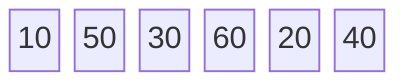

# Linear Shoal

- **Array or Vector** - `vector<type>`
  - **Header**: `<vector>`
  - A dynamic **Array** that stores elements in contiguous memory locations
  - Provides `O(1)` random access to elements using indices

  - Available operations:
    - `push_back(value)`: Insert an element at the **End** of the `vector` - *amortized Time Complexity*: `O(1)`
    - `pop_back()`: Remove the **Last Element** of the vector - *Time Complexity* `O(1)`
    - `insert(v.begin() + pos, value)`: Insert an **Element** at a specific position - *Time Complexity*: `O(n)`
    - `erase(v.begin() + pos)`: Removes the element at a **Specific Position** or a **Interval Of Elements** using `v.erase(v.begin() + start, v.begin() + end)` - *Time Complexity*: `O(n)`
    - `back()`: Accesses the **Last Element** of the vector - time *complexity*: `O(1)`



---

- **Stack** - `stack<type>`
  - **Header**: `<stack>`
  - A**LIFO** - `Last-In, First-Out`: The last element added is the first one to be removed.

  - Available operations:
    - `push(value)`: Insert an **Element** at the top of the `stack` - *Time Complexity*: `O(1)`
    - `pop()`: Remove the **Top Element** of the `stack` - - *Time Complexity*: `O(1)`
    - `top()`: Access the **Top Element** of the `stack` without removing it - - *Time Complexity*: `O(1)`

  - **Monotonic Stack**

    - A **Stack** maintained in a specific order:
  
      - **Increasing Stack**: Elements are maintained in **Increasing** order from bottom to top
  
      ```mermaid
      block-beta
          columns 6
          A["10"] B["20"] C["30"] D["40"] E["50"] F["60"]
      ```
  
      - **Decreasing Stack**: Elements are maintained in **Decreasing** order from bottom to top
  
      ```mermaid
      block-beta
          columns 6
          A["60"] B["50"] C["40"] D["30"] E["20"] F["10"]
      ```
  
    - *Time Complexity*: `O(n)` overall, each element is pushed and popped at most once
    - *Space complexity*: `O(n)` in the worst case

---

## CLASS

- **Class**
  - **Header**: `None`
  - A **User-Defined Type** that groups **Data** and **Functions** together to manage an object's state and behavior

  - It uses the following **Access Specifiers**:
    - `public`: Accessible from outside the `class`
    - `private`: Accessible only within the `class` and its `friends`
  - By **Default** is `private`

  - **Member Initialization List**
    - initialize **Class Members** directly when an object is constructed
    - Can only be used in **Constructors**

  ```cpp
    ClassName(value1, value2, ...) : member1(value1), member2(value2), ...
    {
    }
  ```

  - **Constructor**: A special member function used to initialize an `object`, with the same name as the `class` and no return type

  ```cpp
      ClassName()
      {
      }
  ```

  - **Destructor**
    - A **special member function** called when an `object` is **destroyed**, used to perform **cleanup operations**
    - It has the same name as the `class`, preceded by `~`.

  ```cpp
      ~ClassName()
      {
      }
  ```

  - **Operator Overloading**
    - Customize the **Behavior** of `operators` for **User-Defined Types**, such as `+, -, ==, etc`
    - `Operators` cannot be `overloaded` for **built-in types** alone

    - It can be:
      - **Unary Operators**: Operate on a single **Operand** - `-`, `++`, `--` ect
      - **Binary Operators**: Operate on two **Operands** - `a + a`, `b - b`, `c * c`
    - In a **Binary Operator**, `other` represents the **Other Operand** - `Right Operand`
  
  ```cpp
      //Unary operators
      type operator-()
      {
      }

      //Binary operators
      type operator-(type &other)
      {
      }
  ```

---

### Basic Function

| **FUNCTION** | **LIBRARY** | **DEFINITION** |
| :---: | :---: | :--- |
| `stoi(value)` | `<string>` | Convert a **String** to a **Integer** |
| `size()` | `None` | Returns the number of elements contained in a **Container** or the number of characters in a **String** |
| `empty()` | `None` | Checks whether a **Container** or **String** has no `elements or characters` and returns `true` if empty, otherwise `false` |
| `abs(value)` | `<iostream> <cmath>` | Return the **Absolute Value** of a number - `<cmath>` for floating-point types |
| `v.begin()` | `None` | Return an **Iterator** tp the **First Element** |
| `v.end()` | `None` | Return an **Iterator** to the position **After** the **Last Element** |

#### Extra

`static_cast<type>(value)`: Explicitly converts a **Value** from one type to **Another**
