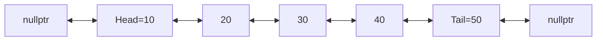
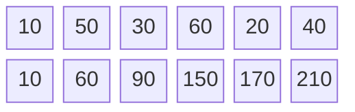

# Association Slope

- **Linked List**
  - **Header**: `None`
  - A **Linear Data** structure where **Elements** are stored in `nodes`, with each `node` containing **Data** and a pointers linking it to other `nodes`
  - **Types**:
    - **Singly Linked List**: Each `node` contains a pointer to the `next node`, forming a sequence from **Head** to **Tail**, ending with `nullptr`
    - **Doubly Linked List**: Each `node` contains pointers to the `previous node` and the `next node`, allowing traversal in **Both Directions**

  - **Dummy Node**: An **Optional Special Node** that does not contain meaningful data and is used to **Simplify Operations**, especially at the **Head**

  - To **Create** a `node` dynamically, we use `new ListNode()`
  - To **Clean** the entire `Linked List`, we must delete all dynamically allocated `nodes` using `delete(node)`

  - _Time Complexity_:
    - **Singly Linked List**:
      - _Access / Search_: `O(n)`
      - _Insert / Delete at Head_: `O(1)`
      - _Insert at Tail_: `O(1)` - If **Tail Pointer** Is **Available**
      - _Delete at Tail_: `O(n)`
      - _Insert After a Given Node_: `O(1)` - If **Node Pointer** Is **Available**

    - **Doubly Linked List**:
      - _Access / Search_: `O(n)`
      - _Insert / Delete at Head_: `O(1)`
      - _Insert / Delete at Tail_: `O(1)` - If **Tail Pointer** Is **Available**
      - _Insert / Delete at a Given Node_: `O(1)` - If **Node Pointer** Is **Available**

```cpp
  // Definition for Singly-Linked List.
  struct ListNode
  {
    int val;
    ListNode *next;
    ListNode() : val(0), next(nullptr)
    {
    }
  };
```


```cpp
  // Definition for Doubly-Linked List.
  struct ListNode
  {
    int val;
    ListNode *next;
    ListNode *prev;
    ListNode() : val(0), next(nullptr), prev(nullptr)
    {
    }
  };
```



---

- **Map**
  - They are **associative containers** that store elements as **key-Value Pairs**

  - **Common Operations**:
    - `count(key)`: Check whether **Key** exists - returns `1` if found, otherwise `0`

  - There are two main types:
    - **map** - `map<key, value>`
      - **Header**: `<map>`
      - Stores **key-Value Pairs** sorted by **key** - ascending by **Default**
      - Searching, inserting and removing **Elements** have `O(log n)` _time complexity_

    ```mermaid
      block-beta
      columns 4
      A["A=10"] B["B=20"] C["C=30"] D["D=40"]
    ```

    - **unordered_map** : `unordered_map<key, value>`
      - **Header**: `<unordered_map>`
      - Stores **key-Value Pairs** without any guaranteed order, using a **Hash Table**
      - Searching, inserting and removing elements have `O(1)` _average complexity_ and `O(n)` _worst-case complexity_

    ```mermaid
      block-beta
      columns 4
      D["D=40"] A["A=10"] C["C=30"] B["B=20"]
    ```

---

- **Prefix Sum**
  - A **Technique** where you create an array to store the **Cumulative Sum** of **Elements** from the beginning up to and including each **Element**, allowing the sum of any **Sub-Range** to be calculated in `O(1)` _time complexity_

```cpp
  sum[i] = sum[i] + sum[i - 1];
```


