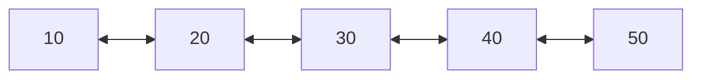
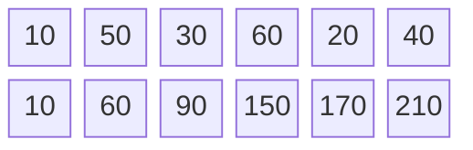

# Association Slope

- **Linked List**
  - A linear data structure where elements are stored in nodes, with each node containing data and a pointer or **reference** to the next node, connected from head to tail

---

- **Prefix Sum**
  - A technique where you create an array to store the cumulative sum of preceding values, allowing you to calculate the sum of any sub-range in `O(1)` time

