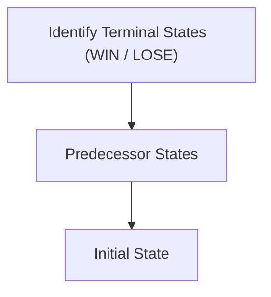

# Stategy Summit

- **Greedy**
  - Is an algorithmic strategy that takes the option that looks **best** at that moment
  - The objective is to arrive at the **best overall solution**

  ```mermaid
  block-beta
      columns 6
      A["10"] B["5"] C["2"] D["1"] E["50"] F["20"]
  ```

  - **Subject**: Need to arrive at **18**
    - `Vector<int> coins = {10, 5, 2, 1, 50, 20}`;
    - Takes **10** - `18 - 10 = 8`
    - Takes **5** - `8 - 5 = 3`
    - Takes **2** - `3 - 2 = 1`
    - Takes **1** - `1 - 1 = 0`
    - The other coins are **discarded**
    - `10 + 5 + 2 + 1 = 18`

---

- **Dynamic Programming**
  - Solving a problem by dividing it into smaller subproblems and saving the calculated results so they can be reused avoiding unnecessary recalculations
  - It can use a memo `e.g. a vector` to save data

---

- **2D Dynamic Programming**
  - The same as **Dynamic Programming**, but the memo has two dimensions, usually represented as `dp[i][j]`, where the state depends on two variables

---

- **Retrograde Analysis**
    Instead of simulating the game from the initial position, we consider all possible game states and solve them backwards, starting from the states whose outcome is **already known**


