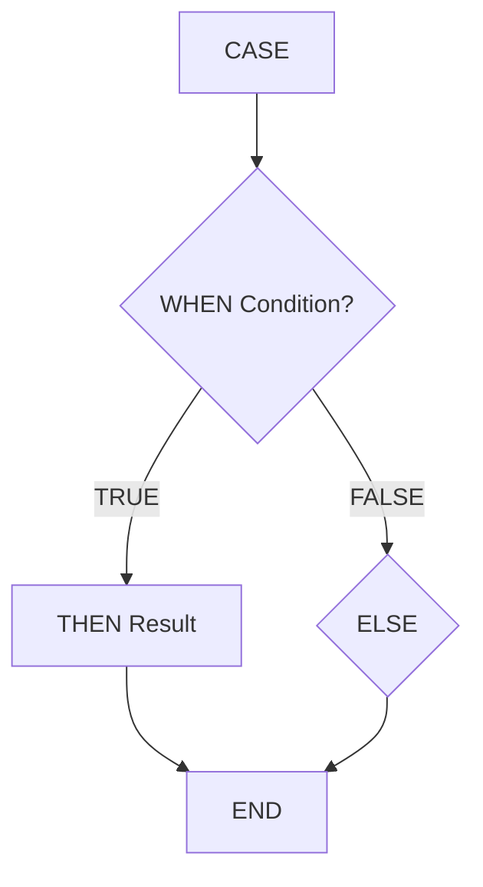

# Filtering & Aggregation

This section introduces **Aggregate Functions** and how their arguments can include a **Subquery**

The **Keywords** i encountered in this section are:

| **KEYWORD**       | **DEFINITION**                                                       |
| :---------------- | :------------------------------------------------------------------- |
| `COUNT()`         | Counts all **Rows** or non-NULL **Values** depending on the argument |
| `SUM()`           | Calculates the total of numeric **Values**                           |
| `SELECT DISTINCT` | Returns only **Distinct Rows**, removing duplicate results           |

For the **Tables** i explored a new definition:

- `CHECK (Element IN (...))`-> Checks whether the **Value** belongs to the allowed set of **Elements**

---

The following flowchart shows how a **CASE WHEN Expression** works

