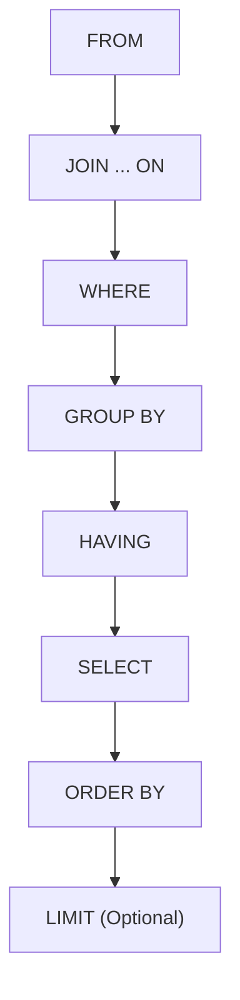

# Documentation

A personal learning repository focused on understanding **SQL Fundamentals** through practical exercises and problem-solving

This repository contains a collection of SQL exercises inspired by **LeetCode**

This repository is a learning **Guide** for myself
Each section has its own **README.md**, focusing on a specific **SQL Topic**, introducing new `keywords`, concepts, examples and approaches

## Execute and Run

To execute and test the SQL scripts, you need SQLite3 installed

**Step 1** - Initialize the Database - **DB**

```bash
sqlite3 -header -column -nullvalue NULL Your_name_for_database.db < Setup.sql
```

*Please substitute **Your_name_for_database** with your favorite database name*

**Step 2** - Execute the **Solution**

```bash
sqlite3 -header -column -nullvalue NULL Your_name_for_database.db < Solution.sql
```

## SQL Keyword Reference

| **Keyword** | **Definition** |
| :--- | :--- |
| `SELECT` | Specifies which **Columns** should be returned |
| `FROM` | Specifies the source **Table** |
| `JOIN ... ON` OR `INNER JOIN` | Combines **Rows** from different **Tables** using a matching condition |
| `WHERE` | Filters individual **Rows** before grouping |
| `GROUP BY` | **Groups** rows that share the same values in specified **Columns** |
| `HAVING` | Filters **Groups** |
| `ORDER BY` | Sorts the resulting rows, using `ASC` - **Ascending** by **Default** or `DESC` - **Descending** when specified |
| `LIMIT` | **Limits** the number of returned rows |

### ORDER

The following flowchart represents the logical processing order of a **SQL query**

The logical processing order is:


